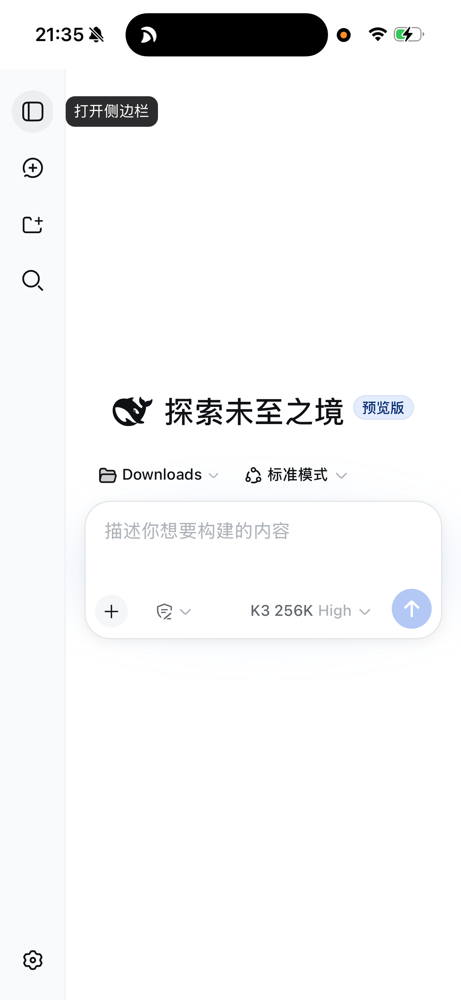
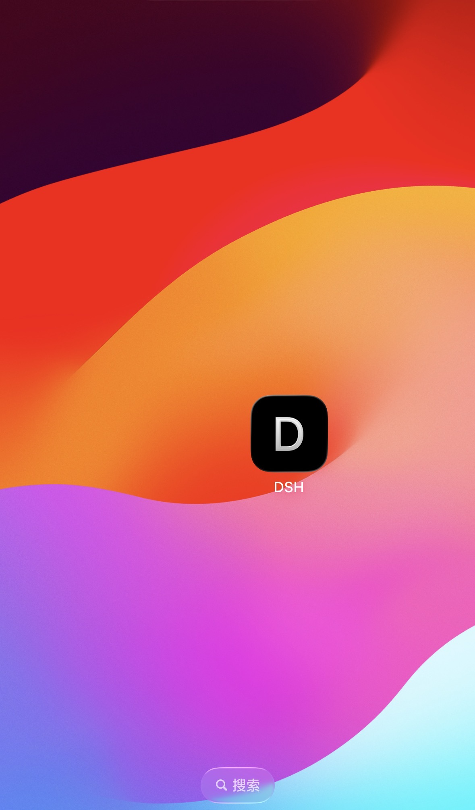

# dsh-phone-remote

**[English](README.md)** | 简体中文


让 **DeepSeek Harness（DSH）** 在手机上用——像 Claude Code 的 remote control 一样：出门在外也能发消息、看 Agent 实时干活、批准操作。

- 💰 零成本（Cloudflare 免费快速隧道）
- 📱 手机端**不用装 App、不用开 VPN**，iPhone / 安卓完全一样（不占 iPhone 唯一的 VPN 槽位，和代理 App 无冲突）
- 🖥️ **两种接法**：连桌面版 Harness 本体（同一实例），或托管一个独立的 `dsh web`
- 💻 电脑端支持 **macOS / Linux / Windows**
- 🔒 自带密码登录网关（DSH 本身没有登录机制，直接暴露等于把电脑挂公网裸奔）
- 🔄 常驻自启：电脑重启、进程崩溃都会自动恢复
- 🧩 通用：把 `auth` 设成 `none`，`upstream` 指向任意本地 Web 应用，这套方案同样适用

## 快速启动：让你电脑上的 DSH 自己装（最懒的方式）⚡

电脑上已经跑着 DSH？连终端都不用开。直接在 DSH 的对话框里发这句话：

> 帮我安装手机远程访问。克隆 https://github.com/Junfei-Z/dsh-phone-remote 到本地，读它的 README，然后执行 `./install.sh --desktop`（我是桌面版；如果我其实没有桌面版就改用 `--web`），装完把手机端网址和访问密码告诉我。

DSH 会自己克隆、装依赖、配服务，最后把**网址和密码**直接给你——你只管去手机上打开。🤯

（Linux 用 `./install-linux.sh`；Windows 用户让 DSH 读 `windows/start-dsh-remote.ps1` 帮你跑。）

## 效果

```
手机浏览器 → https://xxx.trycloudflare.com → 输一次密码 → 完整的 DSH GUI
（发消息 / 看实时输出 / 批准工具调用 / 断线自动重连 / 添加到主屏幕）
```

<p align="center">
  
  &nbsp;&nbsp;
  
</p>

<p align="center"><i>左：iPhone 上运行的完整 DSH 控制台；右：添加到主屏幕后就像一个 App</i></p>

## 平台支持

| 组合 | 支持情况 |
|---|---|
| Mac → iPhone | ✅ 一键脚本（`install.sh`） |
| Mac → 安卓 | ✅ 同一脚本（手机端操作完全一样） |
| Linux → 任意手机 | ✅ 一键脚本（`install-linux.sh`，systemd 用户服务） |
| Windows → 任意手机 | ⚠️ 半自动（`windows/start-dsh-remote.ps1`，自启动见下文；欢迎 PR） |

**手机端没有区别**：iPhone 和安卓都是"浏览器打开网址 → 输密码 → 添加到主屏幕"，iPhone 用 Safari，安卓用 Chrome/系统浏览器即可。

## 两种方案：手机连的是哪个 DSH？

同一套密码网关 + 隧道，上游（upstream）有两种接法，装的时候选一个，之后随时可换：

| | **方案 A · 桌面版本体**（装了桌面版就用这个） | **方案 B · 独立 `dsh web`** |
|---|---|---|
| 手机上看到的是 | 电脑桌面版**正在用的那个实例**：同一工作区、同一批会话、同一份实时状态 | 另起的一个 `dsh web` 进程（3080），会话历史共享，但**不是**桌面版正在跑的那个实例 |
| 前提 | DeepSeek Harness.app 要开着（端口每次启动随机） | 由 launchd / systemd 托管，开机自启，不需要桌面版 |
| 电脑上需要 | 桌面版 App | `dsh` 命令（没有也行，脚本用 `npm exec` 兜底） |
| 端口 | 随机（网关自动发现） | 固定 `127.0.0.1:3080` |
| 适合 | 出门在外接管你**正在用**的那个会话 | 没装桌面版；或想给手机一个干净独立的入口 |

```zsh
./install.sh --desktop   # 方案 A
./install.sh --web       # 方案 B
./install.sh             # 自动判断：有 /Applications/DeepSeek Harness.app 就 A，否则 B
```

切换方案重跑对应命令即可，密码和隧道服务沿用（网址会重新分配）。

### 方案 A：为什么要"签发 cookie"

DSH 0.2 起，每个进程启动时生成一个随机 launch token，只印在启动 URL（`?token=...`）里，用来换一个签名 cookie；桌面版的 Web GUI 又只监听**随机** loopback 端口。隧道那头拿不到这个 token，也猜不到端口。

所以网关的做法是：从 `~/.dsh/.credentials.yaml` 里持久化的 `client-connection/browser-session` 密钥，为 `127.0.0.1:<当前端口>` **现场签一个 DSH 认的会话 cookie** 注入请求；端口在转发前用 `ps` + `lsof` 确认（8 秒缓存、单飞探测，桌面版重启换端口会自动跟上）。**DSH 本体零改动。**

### 方案 B：为什么也能用

网关按固定 `http://127.0.0.1:3080` 转发并注入同一种 cookie，所以新版 `dsh web` 的 token 门槛也顺带绕过了；`com.deepseek.dsh-web`（Linux 是 `dsh-web.service`）负责常驻。

### 两种方案的常见故障

| 手机上的现象 | 原因 / 处理 |
|---|---|
| 「连不上本机的 DSH」 | A：桌面版没开，或刚重启还在启动；B：3080 没在跑（`launchctl list | grep dsh`） |
| 「DSH 拒绝了这个会话（401）」 | 网关的 credentials 不是该进程用的那份（`DSH_HOME` 不同）。改 `~/.dsh/remote-auth.json` 里的 `credentialsFile`，再 `launchctl kickstart -k gui/$(id -u)/com.dsh.auth-proxy` |
| 桌面版重启后手机打不开 | 一般刷新一次即可（网关会重新发现端口）；持续不行就看 `~/.dsh/logs/auth-proxy.err.log` |

## 原理：为什么 DSH 默认连不上，这套又怎么解决

`dsh web` 启动的 GUI 只监听 `127.0.0.1:3080`，而且 `--host 0.0.0.0` 被官方刻意禁止——因为 GUI 能直接在你电脑上执行代码，而它**没有内置账号体系**。它有一道"浏览器信任围栏"（校验 Host/Origin 头，防 DNS rebinding 和 CSRF），但那是防攻击的，不是登录认证。

所以"手机访问"的本质是三个独立的问题，各用一招解决：

```
┌─────────┐   HTTPS    ┌──────────────┐  隧道(出站)  ┌──────────────────────────────┐
│ 手机浏览器│ ────────→ │ Cloudflare   │ ───────────→ │ 你的电脑（无需公网 IP/端口映射）│
└─────────┘           │ 边缘节点      │              │                              │
                      └──────────────┘              │  ③ dsh-auth-proxy :8443      │
                                                    │   密码登录 + 注入 DSH cookie   │
                                                    │   ↓ 改写 Host / Origin        │
                                                    │  ② 上游（二选一）              │
                                                    │   A 桌面版本体（随机端口，自动发现）│
                                                    │   B dsh web :127.0.0.1:3080   │
                                                    │   围栏看到"本机请求"，原生放行  │
                                                    └──────────────────────────────┘
```

1. **打通网络** —— `cloudflared` 从电脑**主动向外**建立到 Cloudflare 的加密隧道。不需要公网 IP、不需要碰路由器、天然 HTTPS。全平台都有官方版本。
2. **补上登录** —— 一个零依赖的 Node 网关（`proxy/dsh-auth-proxy.mjs`）挡在隧道和 DSH 之间：没密码只看到登录页，登录后给 180 天有效的签名 Cookie，密码错误 8 次锁 5 分钟。跨平台。
3. **过围栏 + 过 token** —— 网关转发时把 `Host`/`Origin` 改写成 loopback，围栏就认为请求来自本机；同时用 `~/.dsh/.credentials.yaml` 里的持久密钥现场签一个 DSH 认的会话 cookie 注入（新版 `dsh web` 的 launch token 门槛也一并绕过），**DSH 零改动**。

唯一因系统而异的是"自启动"这层：macOS 用 launchd，Linux 用 systemd，Windows 用任务计划/启动文件夹。

## 手动安装

前置：**Node.js ≥ 22.18（或 24）**，以及二选一——装了 DeepSeek Harness 桌面版（方案 A），或 `npm exec @deepseek-ai/dsh web` 能跑通（方案 B）。

> ⚠️ Node 版本很关键：dsh 的入口用 `import.meta.main` 判断"是否被直接执行"，那是 22.18+ / 24 才有的 API。
> 用旧 Node 跑 `dsh web` 会**静默退出 0**——不报错、不打印、也不监听端口。`install.sh` 会自动挑一个能用的 node，
> 找不到会直接提示你升级。
>
> 方案 B 用 `npx` 兜底时，装到的 `dsh` 版本可能和桌面版不一致（会话数据格式有差异时先 `npm i -g @deepseek-ai/dsh@<同版本>`）。

### macOS

```zsh
git clone https://github.com/Junfei-Z/dsh-phone-remote.git
cd dsh-phone-remote
./install.sh --desktop   # 方案 A：连桌面版本体
./install.sh --web       # 方案 B：托管独立 dsh web
./install.sh             # 不填参数则自动判断
```

`install.sh` 会自动用 Homebrew 装 cloudflared（若缺），配好 launchd 常驻服务，最后打印手机网址和密码。

### Linux

```bash
git clone https://github.com/Junfei-Z/dsh-phone-remote.git
cd dsh-phone-remote
./install-linux.sh  # cloudflared 需先自行安装（脚本会给出链接）
```

用的是 systemd 用户服务；想要"未登录也开机自启"：`sudo loginctl enable-linger $USER`。

### Windows（半自动）

```powershell
git clone https://github.com/Junfei-Z/dsh-phone-remote.git
cd dsh-phone-remote
powershell -ExecutionPolicy Bypass -File .\windows\start-dsh-remote.ps1
```

开机自启（二选一）：
- 把该脚本的快捷方式放进 `shell:startup` 文件夹；或
- `schtasks /create /tn "DSH-Remote" /sc onlogon /tr "powershell -WindowStyle Hidden -ExecutionPolicy Bypass -File \"%USERPROFILE%\.dsh\bin\start-dsh-remote.ps1\""`（先把脚本复制到该路径）

> Windows 路径未实机测试，遇到问题欢迎提 Issue / PR。

## 手机端（iPhone / 安卓相同）

1. 浏览器打开安装时打印的网址
2. 输入访问密码（180 天不用再输）
3. 分享/菜单 → **添加到主屏幕** → 以后点图标即用

## 升级为固定网址（可选）

快速隧道的网址在电脑重启后会变（新网址永远在 `~/.dsh/remote-url.txt`，Windows 在 `%USERPROFILE%\.dsh\remote-url.txt`）。想要固定域名：

1. 买一个域名托管到 Cloudflare（免费套餐即可，.xyz/.top 首年几块钱）
2. Cloudflare Zero Trust → Networks → Tunnels → 创建 tunnel，Public Hostname 指到 `http://localhost:8443`
3. 建议同时加 Access 应用（邮箱验证码登录），或继续用本仓库的密码网关
4. 隧道改用官方常驻方式：`cloudflared service install <token>`

## FAQ

**桌面版还是独立 web 版？** 装了 DeepSeek Harness 桌面版就用方案 A（`--desktop`）——手机上看到的就是电脑上正在用的那个实例；没装、或想要一个不依赖 App 的常驻入口就用方案 B（`--web`）。详见上面的「两种方案」表格。

**安全吗？** 公网只能摸到带密码的网关；DSH 本体只听 127.0.0.1。全程 HTTPS。密码在 `~/.dsh/remote-auth.json`，改 `password` 字段即换密码。网关只用 `~/.dsh/.credentials.yaml` 里的密钥在**本机内存**里签 cookie，不会把它发给手机，也不会写到别处；那个文件本来就是 600 权限。千万不要把没有鉴权的 DSH 直接 `--host 0.0.0.0` 或用裸隧道暴露。

**和 Tailscale 方案比？** Tailscale 也很棒（私有组网），但 iPhone 同时只能开一个 VPN 隧道——常用代理 App 就会冲突。本方案对手机就是"一个网址"，零冲突。

**Mac 合盖/睡眠？** macOS 安装包带 `caffeinate -s` 服务：接电源时不睡眠，拔电池自动失效。

**卸载**：macOS `./uninstall.sh`；Linux `systemctl --user disable --now dsh-auth-proxy dsh-cloudflared dsh-web` 并删 `~/.config/systemd/user/dsh-*`。

## 文件说明

| 路径 | 作用 |
|---|---|
| `proxy/dsh-auth-proxy.mjs` | 密码登录网关（零依赖 Node）：两种上游模式 + 注入 DSH 会话 cookie |
| `scripts/dsh-web.sh` | 方案 B 的 DSH GUI 启动器（含端口等待，和平接管） |
| `scripts/dsh-cloudflared.sh` | 隧道包装（自动记录分配的网址） |
| `launchd/*.plist` | macOS 常驻服务模板 |
| `systemd/*.service` | Linux 常驻服务模板 |
| `windows/start-dsh-remote.ps1` | Windows 启动脚本（方案 B） |
| `install.sh` / `install-linux.sh` / `uninstall.sh` | 安装与卸载 |
| `CHANGELOG.md` | 版本变更 |

## License

MIT
