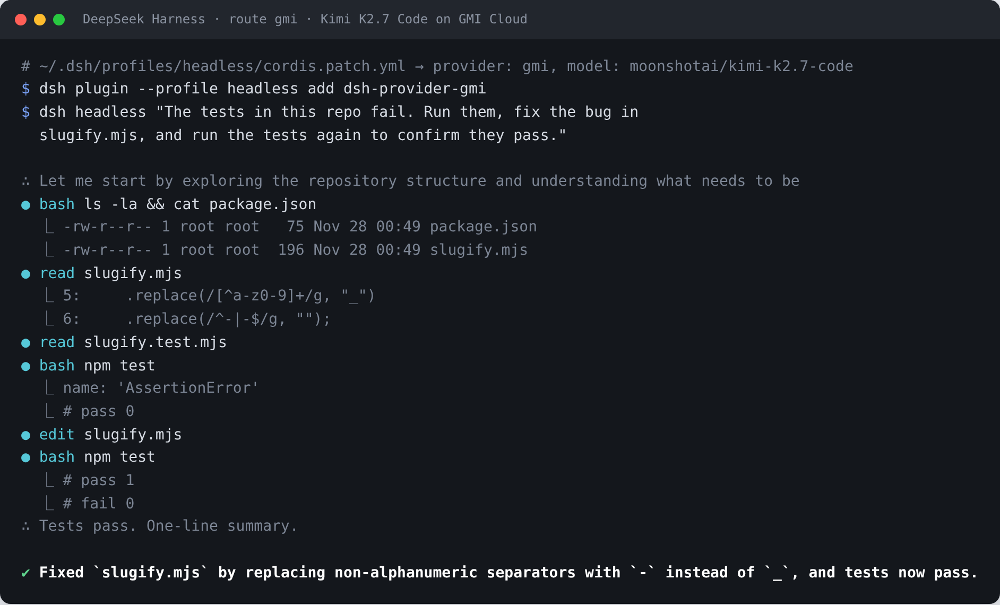
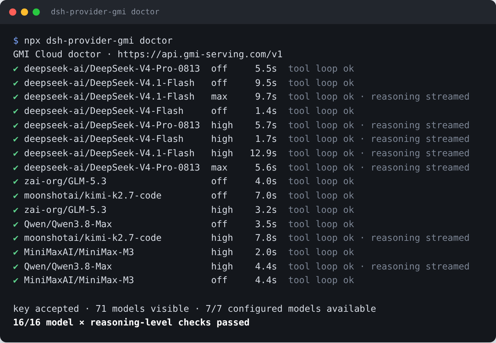

# dsh-provider-gmi

[](https://www.npmjs.com/package/dsh-provider-gmi)
[](https://github.com/Junfei-Z/dsh-provider-gmi/actions/workflows/ci.yml)
[](LICENSE)

**English** | [简体中文](README.zh-CN.md)

Run **DeepSeek Harness (DSH)** agents on models served by **[GMI Cloud](https://www.gmicloud.ai)**'s Inference Engine: one plugin, one API key.

- 🔌 **One command**: `dsh plugin add dsh-provider-gmi` adds a `GMI Cloud` route to the model picker
- 🧠 **7 coding-ready models, all checked**: DeepSeek V4.1 Flash, DeepSeek V4 Pro (0813), DeepSeek V4 Flash, Kimi K2.7 Code, GLM-5.3, Qwen3.8 Max, MiniMax M3
- 🛠️ **Agent-grade, not just chat**: every model passes streamed tool calls across a multi-turn tool loop, and the reasoning picker sends each model's own on/off switch
- 🩺 **`npx dsh-provider-gmi doctor`**: re-runs those checks against your own key in about a minute
- 🔒 **No secret in config**: the route names a credential reference (`GMI_API_KEY`); DSH resolves it per request
- 🪶 **Zero code inside DSH**: a declarative bundle patch for DSH's stock `llm-pi-ai` adapter, so nothing runs in your agent's process

<p align="center">
  
</p>
<p align="center"><i>A real <code>dsh headless</code> run on the <code>gmi</code> route: the agent runs the tests, reads the code, edits it and re-runs the tests to green.</i></p>

## Quick start

**1. Install the plugin** into the profile you use:

```sh
dsh plugin --profile web add dsh-provider-gmi      # or: tui / headless
```

The desktop app installs the same package from **Settings → Plugins → Install**.

**2. Give DSH your GMI Cloud API key** (create one in the GMI Cloud console). Pick one:

- Save it in DSH's settings as the `GMI_API_KEY` credential. DSH stores it in `~/.dsh/.credentials.yaml` (owner-only), under `refs.GMI_API_KEY`.
- Or launch DSH with it in the environment: `GMI_API_KEY=... dsh web`.
- Or put `GMI_API_KEY=...` in `~/.dsh/.env`.

DSH resolves the key in that order: saved key first, then the launch environment, then `.env` files.

**3. Pick a model.** In the model picker choose e.g. **DeepSeek V4.1 Flash · GMI**, or make GMI the default in your profile's patch layer (`~/.dsh/profiles/<profile>/cordis.patch.yml`):

```yaml
- id: agent-default-model
  config:
    provider: gmi
    model: deepseek-ai/DeepSeek-V4.1-Flash
    reasoningEffort: high      # optional; levels per model are listed below
```

**4. Check it** (optional, needs Node ≥ 22.18):

```sh
GMI_API_KEY=... npx dsh-provider-gmi doctor
```

<p align="center">
  
</p>

## Models

| Route model id | Context | Reasoning levels | Notes |
|---|---|---|---|
| `deepseek-ai/DeepSeek-V4.1-Flash` | 1M | off · high · max | Default pick for everyday agent work |
| `deepseek-ai/DeepSeek-V4-Pro-0813` | 1M | off · high · max | Dated snapshot of DeepSeek V4 Pro |
| `deepseek-ai/DeepSeek-V4-Flash` | 1M | off · high | Quick edits and subagents |
| `moonshotai/kimi-k2.7-code` | 256K | off · high | Coding-tuned Kimi |
| `zai-org/GLM-5.3` | 1M | off · high | |
| `Qwen/Qwen3.8-Max` | 256K | off · high | Output capped at 131072 tokens |
| `MiniMaxAI/MiniMax-M3` | 1M | off · high | Reasons only when asked to |

Ids are pinned to dated snapshots where GMI offers one, so a route keeps answering with the same model until this table changes on purpose.

**Want another GMI model?** `npx dsh-provider-gmi models` lists everything your key can reach (★ marks the ones above). Then either let DSH's model settings discover them (they query the route's `/models`), or extend the route in your own patch layer:

```yaml
- id: llm-pi-ai
  config:
    providers:
      gmi:
        models:
          - id: Qwen/Qwen3.8-Flash
            name: Qwen3.8 Flash · GMI
            contextWindow: 1048575
            reasoningEfforts: false   # or declare its levels, see "How it works"
```

A `models` list replaces the route's list rather than extending it, so copy the entries you still want from [`cordis.patch.yml`](cordis.patch.yml).

## How it works

DSH routes model calls through its `llm-pi-ai` adapter, which already speaks the OpenAI Chat Completions protocol GMI serves at `https://api.gmi-serving.com/v1`. This package is a **DSH bundle**: its `package.json` points at [`cordis.patch.yml`](cordis.patch.yml), which DSH layers onto that adapter's config when the plugin is installed. Nothing else is loaded, and uninstalling removes the route.

What the patch adds beyond a bare "custom endpoint" is the per-model detail an agent needs. The detail was measured against the live endpoint and is not inferred:

- **Reasoning switches.** GMI serves models from several vendors, and each one turns thinking on and off differently. Each model declares the matching `thinkingFormat`, so the DSH reasoning picker sends the right field:

  | Format | Models | `off` sends | `high` / `max` sends |
  |---|---|---|---|
  | `deepseek` | DeepSeek V4.1 Flash, V4 Pro 0813, V4 Flash | `thinking: {type: disabled}` | `thinking: {type: enabled}` + `reasoning_effort` |
  | `zai` | Kimi K2.7 Code, GLM-5.3 | `thinking: {type: disabled}` | `thinking: {type: enabled}` |
  | `qwen` | Qwen3.8 Max | `enable_thinking: false` | `enable_thinking: true` |
  | `openai` | MiniMax M3 | nothing | `reasoning_effort` |

- **Capacities.** Context windows come from GMI's `/v1/models`, and output caps were probed per model. Qwen3.8 Max, for example, rejects `max_tokens` above 131072.
- **Tool loops.** Every model was run through the exact loop an agent needs: a streamed tool call, then a tool result sent back, then an answer that must use that result. All of them work without echoing reasoning text back, so no extra compat flags are needed.

The model table lives in [`lib/models.mjs`](lib/models.mjs). `npm run gen` renders the patch from it, and the tests fail if the two drift apart.

## The doctor

```text
npx dsh-provider-gmi [doctor|models] [options]

  doctor            check the key, then run a streamed tool-call loop on every
                    configured model at every reasoning level it offers
  models            list every model the key can reach

  --model <id>      only this model (repeatable)
  --level <level>   only this reasoning level, e.g. off or high (repeatable)
  --key-env <name>  variable holding the key (default GMI_API_KEY)
  --base-url <url>  endpoint (default https://api.gmi-serving.com/v1)
  --json            machine-readable output
```

For each (model, level) pair, the doctor sends the same request shape DSH sends and requires a `read_file` tool call. It then returns a tool result containing a random nonce, and passes only if the final answer quotes that nonce. Exit code 0 means every check passed. The key is read from the environment and is never printed.

## Verified

On 2026-11-28, with DeepSeek Harness `0.2.2-rc.5`, the package was installed through `dsh plugin add` from its packed tarball, then given one task: *"The tests in this repo fail. Run them, fix the bug, and run the tests again."* DSH's session store recorded `provider: gmi` for every run.

| Model on the `gmi` route | Reasoning | What the agent did | Result |
|---|---|---|---|
| DeepSeek V4.1 Flash | default | fixed the separator and the trim regex, re-ran the tests | tests pass |
| DeepSeek V4 Pro 0813 | max | `ls` → glob → read ×3 → test → edit → test | tests pass |
| Kimi K2.7 Code | high | `ls` → read ×2 → test → edit → test | tests pass |
| GLM-5.3 | off | inspect + test → edit → test | tests pass |

The doctor passed 16/16 model × reasoning-level checks on the same day ([screenshot](docs/images/doctor.png)).

## Troubleshooting

| Symptom | Cause / fix |
|---|---|
| `MISSING_CREDENTIAL` naming `GMI_API_KEY` | DSH found no key: save it in settings, or restart DSH with it exported. The launch environment is read once, at startup |
| `HTTP 401` from the doctor or DSH | The key was rejected: check it in the GMI Cloud console |
| `UNKNOWN_MODEL` | The model id is not in the route's list; add it as shown under [Models](#models) |
| doctor: `fetch failed` behind a corporate proxy | Node's `fetch` ignores `HTTPS_PROXY` unless you run with `NODE_USE_ENV_PROXY=1` (Node ≥ 22.21) |
| A model is missing from `doctor` output | Your key cannot see it; `npx dsh-provider-gmi models` shows what it can reach |

## Drive it from your phone

Pair this with [dsh-phone-remote](https://github.com/Junfei-Z/dsh-phone-remote) (`dsh plugin add dsh-phone-gate`). It adds a password-gated tunnel to the DSH web console, so you can start a GMI-backed agent at your desk and approve its tool calls from your phone.

## Development

```sh
npm test          # patch in sync + 14 offline tests (mock GMI server, no key needed)
npm run gen       # regenerate cordis.patch.yml after editing lib/models.mjs
GMI_API_KEY=... npm run doctor
```

Zero runtime dependencies. Node ≥ 22.18.

## License

MIT. This is a community plugin and is not affiliated with or endorsed by GMI Cloud or DeepSeek. Model names belong to their respective owners.
