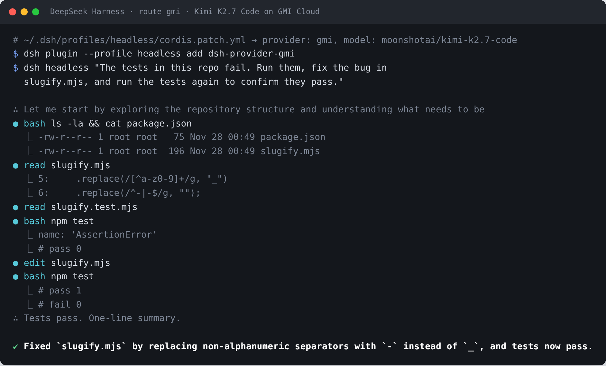
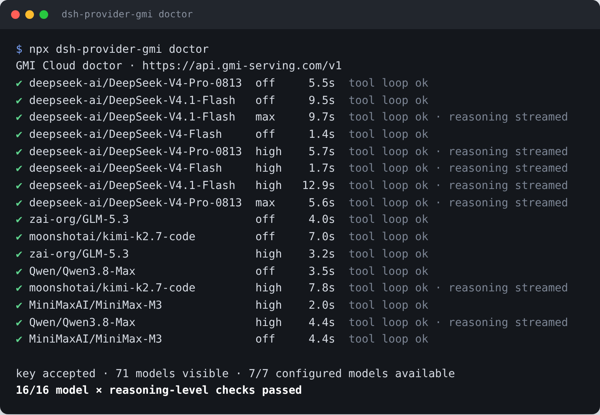

# dsh-provider-gmi

[](https://www.npmjs.com/package/dsh-provider-gmi)
[](https://github.com/Junfei-Z/dsh-provider-gmi/actions/workflows/ci.yml)
[](LICENSE)

[English](README.md) | **简体中文**

让 **DeepSeek Harness（DSH）** 的智能体直接跑在 **[GMI Cloud](https://www.gmicloud.ai)** Inference Engine 托管的模型上：一个插件，一个 API Key。

- 🔌 **一条命令**：`dsh plugin add dsh-provider-gmi`，模型选择器里多出一条 `GMI Cloud` 路由
- 🧠 **7 个可直接写代码的模型，全部实测过**：DeepSeek V4.1 Flash、DeepSeek V4 Pro（0813）、DeepSeek V4 Flash、Kimi K2.7 Code、GLM-5.3、Qwen3.8 Max、MiniMax M3
- 🛠️ **按智能体的标准验证，不只是能聊天**：每个模型都跑通了「流式工具调用 → 回传工具结果 → 基于结果作答」的多轮循环；推理开关按各家模型自己的参数下发
- 🩺 **`npx dsh-provider-gmi doctor`**：用你自己的 Key 一分钟左右重跑全部检查
- 🔒 **配置里没有密钥**：路由里只写凭据引用 `GMI_API_KEY`，由 DSH 每次请求时解析
- 🪶 **DSH 进程里零代码**：纯声明式的 bundle patch，配置的是 DSH 自带的 `llm-pi-ai` 适配器

<p align="center">
  
</p>
<p align="center"><i>一次真实的 <code>dsh headless</code> 运行（<code>gmi</code> 路由）：智能体跑测试、读代码、改代码、再跑测试直到全绿。</i></p>

## 快速开始

**1. 装插件**（装进你在用的 profile）：

```sh
dsh plugin --profile web add dsh-provider-gmi      # 或 tui / headless
```

桌面版在 **设置 → 插件 → 安装** 里装同一个包。

**2. 把 GMI Cloud API Key 交给 DSH**（在 GMI Cloud 控制台创建），三选一：

- 在 DSH 设置里保存为 `GMI_API_KEY` 凭据。DSH 会存进 `~/.dsh/.credentials.yaml`（仅本人可读）的 `refs.GMI_API_KEY`；
- 或带着环境变量启动：`GMI_API_KEY=... dsh web`；
- 或写进 `~/.dsh/.env`：`GMI_API_KEY=...`。

解析顺序：设置里保存的 Key → 启动时的环境变量 → `.env` 文件。

**3. 选模型**：在模型选择器里选 **DeepSeek V4.1 Flash · GMI** 等；或者在 profile 的 patch 层（`~/.dsh/profiles/<profile>/cordis.patch.yml`）把 GMI 设为默认：

```yaml
- id: agent-default-model
  config:
    provider: gmi
    model: deepseek-ai/DeepSeek-V4.1-Flash
    reasoningEffort: high      # 可选；各模型支持的档位见下表
```

**4. 自检**（可选，需要 Node ≥ 22.18）：

```sh
GMI_API_KEY=... npx dsh-provider-gmi doctor
```

<p align="center">
  
</p>

## 模型

| 路由模型 id | 上下文 | 推理档位 | 说明 |
|---|---|---|---|
| `deepseek-ai/DeepSeek-V4.1-Flash` | 1M | off · high · max | 日常智能体任务的默认选择 |
| `deepseek-ai/DeepSeek-V4-Pro-0813` | 1M | off · high · max | DeepSeek V4 Pro 的带日期快照 |
| `deepseek-ai/DeepSeek-V4-Flash` | 1M | off · high | 快速小改动、子智能体 |
| `moonshotai/kimi-k2.7-code` | 256K | off · high | 面向编程调优的 Kimi |
| `zai-org/GLM-5.3` | 1M | off · high | |
| `Qwen/Qwen3.8-Max` | 256K | off · high | 输出上限 131072 tokens |
| `MiniMaxAI/MiniMax-M3` | 1M | off · high | 只有要求时才推理 |

有带日期快照的模型都固定到快照 id，路由背后的模型不会悄悄变。

**想用别的 GMI 模型？** `npx dsh-provider-gmi models` 列出你的 Key 能用的全部模型（★ 是上表里的）。之后可以让 DSH 的模型设置页自动发现（它会请求路由的 `/models`），或者在自己的 patch 层里扩展：

```yaml
- id: llm-pi-ai
  config:
    providers:
      gmi:
        models:
          - id: Qwen/Qwen3.8-Flash
            name: Qwen3.8 Flash · GMI
            contextWindow: 1048575
            reasoningEfforts: false
```

注意 `models` 是**整体替换**，不是追加，需要保留的条目请从 [`cordis.patch.yml`](cordis.patch.yml) 一并拷过来。

## 原理

DSH 通过自带的 `llm-pi-ai` 适配器发模型请求，它本来就支持 GMI 在 `https://api.gmi-serving.com/v1` 提供的 OpenAI Chat Completions 协议。本包是一个 **DSH bundle**：`package.json` 指向 [`cordis.patch.yml`](cordis.patch.yml)，安装时 DSH 把它叠加到该适配器的配置上。除此之外不加载任何东西，卸载即移除。

比「填一个自定义端点」多出来的，是智能体真正需要、并且对着线上接口逐个实测得到的每模型细节：

- **推理开关**：GMI 托管多家厂商的模型，每家开关思考的参数都不一样。每个模型声明对应的 `thinkingFormat`，DSH 的推理档位就会下发正确的字段：

  | 格式 | 模型 | `off` 发送 | `high` / `max` 发送 |
  |---|---|---|---|
  | `deepseek` | DeepSeek V4.1 Flash、V4 Pro 0813、V4 Flash | `thinking: {type: disabled}` | `thinking: {type: enabled}` + `reasoning_effort` |
  | `zai` | Kimi K2.7 Code、GLM-5.3 | `thinking: {type: disabled}` | `thinking: {type: enabled}` |
  | `qwen` | Qwen3.8 Max | `enable_thinking: false` | `enable_thinking: true` |
  | `openai` | MiniMax M3 | 不发送 | `reasoning_effort` |

- **容量**：上下文窗口取自 GMI 的 `/v1/models`，输出上限逐个模型探测过（例如 Qwen3.8 Max 拒绝超过 131072 的 `max_tokens`）。
- **工具循环**：每个模型都跑过智能体需要的完整循环（流式工具调用 → 回传工具结果 → 必须用到该结果的回答），且不需要回传推理文本，所以无需额外的兼容开关。

模型表在 [`lib/models.mjs`](lib/models.mjs)，`npm run gen` 由它生成 patch，二者不一致时测试会失败。

## doctor 自检命令

```text
npx dsh-provider-gmi [doctor|models] [选项]

  doctor            校验 Key，然后对每个模型的每个推理档位跑一遍流式工具调用循环
  models            列出 Key 能访问的全部模型

  --model <id>      只测这个模型（可重复）
  --level <level>   只测这个推理档位，如 off、high（可重复）
  --key-env <name>  存放 Key 的环境变量（默认 GMI_API_KEY）
  --base-url <url>  端点（默认 https://api.gmi-serving.com/v1）
  --json            输出机器可读结果
```

每个（模型，档位）组合都按 DSH 的请求形状发送，要求模型发起 `read_file` 工具调用；随后回传一个包含随机 nonce 的工具结果，最终回答必须引用这个 nonce 才算通过。全部通过时退出码为 0。Key 只从环境变量读取，绝不打印。

## 实测记录

2026-11-28，DeepSeek Harness `0.2.2-rc.5`，用 `dsh plugin add` 从打包好的 tarball 安装本插件，交给智能体同一个任务：*「这个仓库的测试挂了。跑测试、修 bug、再跑一遍确认通过。」* DSH 的会话记录里每次运行都是 `provider: gmi`。

| `gmi` 路由上的模型 | 推理档位 | 智能体做了什么 | 结果 |
|---|---|---|---|
| DeepSeek V4.1 Flash | 默认 | 修好分隔符和首尾裁剪的正则，重跑测试 | 测试通过 |
| DeepSeek V4 Pro 0813 | max | `ls` → glob → 读 ×3 → 测试 → 修改 → 测试 | 测试通过 |
| Kimi K2.7 Code | high | `ls` → 读 ×2 → 测试 → 修改 → 测试 | 测试通过 |
| GLM-5.3 | off | 查看并测试 → 修改 → 测试 | 测试通过 |

同一天 doctor 16/16 项模型 × 推理档位检查全部通过（[截图](docs/images/doctor.png)）。

## 排错

| 现象 | 原因 / 解决 |
|---|---|
| 报 `MISSING_CREDENTIAL`，提到 `GMI_API_KEY` | DSH 没找到 Key：在设置里保存，或 export 之后重启 DSH（启动环境只在启动时读取一次） |
| doctor 或 DSH 报 `HTTP 401` | Key 被拒：到 GMI Cloud 控制台核对 |
| `UNKNOWN_MODEL` | 该模型 id 不在路由列表里，按[模型](#模型)一节添加 |
| 在公司代理后面，doctor 报 `fetch failed` | Node 的 `fetch` 默认不读 `HTTPS_PROXY`，加 `NODE_USE_ENV_PROXY=1` 运行（Node ≥ 22.21） |
| doctor 输出里少了某个模型 | 你的 Key 看不到它；用 `npx dsh-provider-gmi models` 查看可用模型 |

## 用手机遥控

搭配 [dsh-phone-remote](https://github.com/Junfei-Z/dsh-phone-remote)（`dsh plugin add dsh-phone-gate`）使用：它给 DSH 网页控制台加一个带密码的隧道。在电脑前启动跑在 GMI 上的智能体，离开工位后也能在手机上批准它的工具调用。

## 开发

```sh
npm test          # 检查 patch 是否同步 + 14 项离线测试（模拟 GMI 服务器，不需要 Key）
npm run gen       # 修改 lib/models.mjs 后重新生成 cordis.patch.yml
GMI_API_KEY=... npm run doctor
```

零运行时依赖，Node ≥ 22.18。

## 许可

MIT。本项目是社区插件，与 GMI Cloud、DeepSeek 无隶属或背书关系；模型名称归各自所有者。
